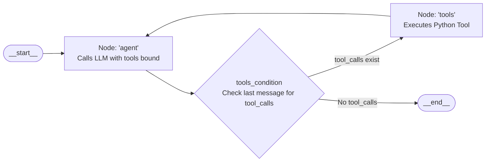

# Evonence AI: Deep Technical Interview Preparation
## Advanced Engineering Guide: LangChain, LangGraph, Architecture, Data Flow & Python APIs

This guide provides **40 rigorous, in-depth technical interview questions and comprehensive answers** tailored specifically to the **Evonence AI Enterprise Sentiment Analysis Agent** codebase (`d:\Evonence_ADK`). 

Unlike introductory overviews, this document probes the **under-the-hood mechanics, framework internals, execution lifecycles, and architectural trade-offs** across three specialized domains:
1. **LangChain & LLM Integration (Q1–Q10)**
2. **LangGraph & Agentic Workflow Orchestration (Q11–Q20)**
3. **System Implementation, Data Flow, Security & Python APIs (Q21–Q40)**

---

# Part 1: LangChain & Model Integration Deep Dive (Q1–Q10)

### Q1. Why did you use LangChain AWS (`ChatBedrock`) instead of directly invoking AWS Bedrock via `boto3` (`invoke_model`) or using legacy `BedrockLLM`?
**Core Answer:**  
We utilized `ChatBedrock` from `langchain_aws` because it natively implements LangChain's **Chat Model interface** (`BaseChatModel`), supporting structured message sequences (`SystemMessage`, `HumanMessage`, `AIMessage`, `ToolMessage`) and automated tool calling via the AWS Bedrock Converse API abstraction.

**Under-the-Hood Mechanics & Code Grounding:**  
- When calling `boto3.client('bedrock-runtime').invoke_model()`, the developer must manually format the provider-specific JSON payload (e.g., Anthropic Claude vs. Amazon Nova format differ drastically), serialize JSON, parse raw byte buffers from `response['body'].read()`, and manually extract tool-call metadata.
- Legacy `BedrockLLM` in LangChain only operates on raw text completions (`str -> str`), which cannot handle native multi-turn conversation or structured function calling.
- In [code/main.py:L30-L34](code/main.py#L30-L34), `ChatBedrock(client=boto3_client, model_id='amazon.nova-pro-v1:0', model_kwargs=dict(temperature=0.1))` acts as a standardized wrapper. It converts LangChain's universal `BaseMessage` objects into the exact Amazon Nova converse request schema and translates Bedrock's HTTP response back into an `AIMessage` with parsed `tool_calls`.

**Interview Defense / Gotcha:**  
*Interviewer:* "Doesn't `ChatBedrock` introduce unnecessary latency compared to raw `boto3`?"  
*Defense:* The latency overhead of LangChain's Python wrapper is sub-millisecond, which is negligible compared to the 800ms–2000ms network and inference latency of Bedrock. The developer velocity, unified interface for tool-binding, and standard integration with LangGraph far outweigh the microsecond abstraction cost.

---

### Q2. What is the Runnable Interface (LCEL) in LangChain, and how does your application utilize it?
**Core Answer:**  
The Runnable protocol is LangChain's unified abstraction (LangChain Expression Language or LCEL) that guarantees consistent interfaces across all components via methods like `.invoke()`, `.ainvoke()`, `.stream()`, and `.batch()`.

**Under-the-Hood Mechanics & Code Grounding:**  
- Every core object in our pipeline—including `ChatBedrock`, the structured model (`structured_llm`), our `@tool` functions, and the LangGraph compiled agent (`agent_executor`)—implements the `Runnable` protocol.
- In [code/main.py:L71](code/main.py#L71), we invoke the structured extraction pipeline synchronously: `structured_data = structured_llm.invoke(prompt)`.
- In [code/app.py:L70](code/app.py#L70), the compiled graph agent is executed via `response = agent_executor.invoke({"messages": [("system", system_prompt), ("user", user_input)]})`.
- The Runnable protocol handles type validation, config propagation (like tags, callbacks, and run IDs for tracing), and error bubbling under a uniform standard.

**Interview Defense / Gotcha:**  
If asked how to transition this application from synchronous to asynchronous processing for higher web server throughput, explain that because `agent_executor` is a Runnable, we can replace `.invoke()` with `await agent_executor.ainvoke()` inside an async web framework (like Quart or FastAPI) without rewriting our agent logic.

---

### Q3. How does `llm.with_structured_output(SentimentAnalysisResult)` work internally with Amazon Nova Pro?
**Core Answer:**  
`with_structured_output` binds a Pydantic schema to the model and automatically forces the model to emit outputs conforming to that schema, returning an instantiated Pydantic object rather than an unstructured string.

**Under-the-Hood Mechanics & Code Grounding:**  
- In [code/main.py:L62](code/main.py#L62), `structured_llm = llm.with_structured_output(SentimentAnalysisResult)` converts the `SentimentAnalysisResult` Pydantic class into an internal JSON schema definition.
- Depending on model capabilities, LangChain either passes this schema as a tool/function call definition (forcing the model to invoke that function with arguments matching the schema) or instructs the Bedrock Converse API with structured JSON output constraints.
- When the model returns tokens, LangChain's `PydanticOutputParser` intercepts the raw JSON string payload, validates each field type (`str`, `bool`, `Literal`), and instantiates `SentimentAnalysisResult(pragmatic_analysis=..., surface_sentiment=..., ...)`.

**Interview Defense / Gotcha:**  
*Interviewer:* "What happens if Amazon Nova generates a string that violates the schema, such as an invalid literal?"  
*Defense:* Pydantic raises a `ValidationError`. In [code/main.py:L81-L84](code/main.py#L81-L84), we explicitly wrapped `structured_llm.invoke(prompt)` in a `try/except` block, ensuring that if schema parsing fails, it safely falls back to a default `NEUTRAL` classification and logs `"Error during processing."` without crashing the ingestion worker.

---

### Q4. How does the LangChain `@tool` decorator transform a standard Python function into an LLM-accessible tool?
**Core Answer:**  
The `@tool` decorator wraps a Python function into a `StructuredTool` instance, inspecting the function's signature, docstring, and type annotations to generate an OpenAI/Bedrock-compatible JSON Schema.

**Under-the-Hood Mechanics & Code Grounding:**  
- In [code/main.py:L93-L126](code/main.py#L93-L126), we decorated `calculate_overall_sentiment_distribution` and `query_specific_tweet(tweet_id: str)`.
- At import time, `@tool` parses the Google/Sphinx docstring: the docstring description becomes the tool's `"description"` field in JSON Schema.
- The argument `tweet_id: str` is converted into JSON Schema properties:
  ```json
  {
    "name": "query_specific_tweet",
    "description": "Retrieves the specific classification and the pre-computed logical reasoning for a single tweet ID.",
    "parameters": {
      "type": "object",
      "properties": {
        "tweet_id": {"type": "string"}
      },
      "required": ["tweet_id"]
    }
  }
  ```
- This schema informs the model of what the tool does and what parameters it requires.

**Interview Defense / Gotcha:**  
*Interviewer:* "Why is the docstring so critical in `@tool`?"  
*Defense:* The docstring is the **sole semantic guide** the LLM uses to decide whether to call the tool. If the docstring is vague, missing, or inaccurate, the LLM will hallucinate the answer or call the wrong tool. In `calculate_overall_sentiment_distribution`, our docstring explicitly states: *"The agent MUST use this tool to answer questions about overall percentages or statistics."*

---

### Q5. What is the tool-binding protocol (`bind_tools`), and what payload does AWS Bedrock receive when tools are registered?
**Core Answer:**  
`bind_tools` is the method that attaches tool definitions to a chat model's runtime configuration, converting them into the provider-specific format expected in the API request body.

**Under-the-Hood Mechanics & Code Grounding:**  
- LangGraph's `create_react_agent` internally calls `model.bind_tools(tools)` on the passed `llm`.
- When `ChatBedrock` calls AWS Bedrock's Converse API, it injects a `toolConfig` block containing `tools`:
  ```json
  {
    "toolConfig": {
      "tools": [
        {
          "toolSpec": {
            "name": "calculate_overall_sentiment_distribution",
            "description": "...",
            "inputSchema": {"json": {...}}
          }
        }
      ]
    }
  }
  ```
- The Bedrock engine processes this configuration, allowing Amazon Nova Pro to emit a `toolUse` stop reason along with tool input arguments instead of a direct text response.

---

### Q6. How does LangChain represent message hierarchies, and how does your architecture prevent prompt collision?
**Core Answer:**  
LangChain uses polymorphic message objects inheriting from `BaseMessage`: `SystemMessage` (instruction), `HumanMessage` (user query), `AIMessage` (assistant reasoning or tool calls), and `ToolMessage` (tool execution results).

**Under-the-Hood Mechanics & Code Grounding:**  
- In [code/app.py:L70](code/app.py#L70), we invoke the agent with:
  `agent_executor.invoke({"messages": [("system", system_prompt), ("user", user_input)]})`
- LangChain converts the tuple `("system", system_prompt)` into a `SystemMessage` and `("user", user_input)` into a `HumanMessage`.
- By passing the system prompt as an explicit system message rather than concatenating it into the user prompt string, the Bedrock Converse API isolates system instructions from user-controlled inputs, significantly reducing prompt injection risks.

---

### Q7. How does Pydantic v2 integrate with LangChain in your pipeline, and what advantages does it offer over Pydantic v1?
**Core Answer:**  
In our pipeline, Pydantic v2 (`pydantic>=2.0`) defines the `SentimentAnalysisResult` schema, providing strict compile-time and runtime data validation, C-based parsing performance via `pydantic-core`, and standard JSON Schema generation.

**Under-the-Hood Mechanics & Code Grounding:**  
- In [code/main.py:L37-L43](code/main.py#L37-L43):
  ```python
  class SentimentAnalysisResult(BaseModel):
      pragmatic_analysis: str = Field(description="Analysis of fact vs opinion and implicit context.")
      surface_sentiment: str = Field(description="The literal sentiment of the words.")
      true_intention: str = Field(description="The actual intent of the speaker.")
      contradiction_flag: bool = Field(description="True if surface sentiment contradicts true intention.")
      final_classification: Literal["POSITIVE", "NEGATIVE", "NEUTRAL"] = Field(description="The final strict categorical classification.")
  ```
- Pydantic v2 generates JSON Schema directly using Rust-backed serializers (`model_json_schema()`), which executes 5–20x faster than Pydantic v1.
- Furthermore, `Literal["POSITIVE", "NEGATIVE", "NEUTRAL"]` acts as an enum restriction: if the model outputs `"MIXED"` or `"UNKNOWN"`, Pydantic immediately rejects it, preventing bad categories from polluting our dataset.

---

### Q8. How are `model_kwargs` like `temperature=0.1` passed to AWS Bedrock, and what are the limitations?
**Core Answer:**  
In `ChatBedrock(client=boto3_client, model_id=model_id, model_kwargs=dict(temperature=0.1))`, `model_kwargs` is passed directly into Bedrock's inference configuration parameters (`inferenceConfig: {temperature: 0.1}`).

**Under-the-Hood Mechanics & Code Grounding:**  
- Temperature scales the logits in the final softmax layer of the transformer model ($p_i = \frac{e^{z_i / T}}{\sum e^{z_j / T}}$).
- A temperature of `0.1` compresses the probability distribution towards the argmax token, ensuring highly reproducible, near-deterministic outputs for classification and tool routing.
- **Limitation:** Even at `temperature=0.0` or `0.1`, generative models are **not mathematically deterministic calculators** due to floating-point nondeterminism in GPU/TPU matrix operations across distributed clusters. Hence, temperature reduction alone cannot solve arithmetic hallucination—only external tools (Pandas) can.

---

### Q9. Why did you choose synchronous invocation over token streaming (`.stream()`), and what would be required to support streaming?
**Core Answer:**  
We implemented synchronous `.invoke()` to meet the strict 1-hour hackathon deadline with a clean, stable request-response lifecycle and simple frontend error handling.

**Under-the-Hood Mechanics & Code Grounding:**  
- Supporting token streaming would require:
  1. Switching Flask to server-sent events (SSE) using `Response(generate(), mimetype='text/event-stream')` or moving to FastAPI / WebSocket.
  2. Calling `agent_executor.stream({"messages": [...]}, stream_mode="messages")`.
  3. Handling intermediate tool events: filtering out raw JSON tool calls so the user only sees final conversational tokens.
  4. Updating `script.js` to read from a `ReadableStream` (`response.body.getReader()`) and render Markdown incrementally.

---

### Q10. What are the engineering trade-offs of using LangChain rather than native AWS SDK calls?
**Core Answer:**  
LangChain introduces extra abstraction layers and occasional breaking changes between versions, but provides high-level agent primitives, standard tool interfaces, and rapid multi-provider interchangeability.

**Detailed Trade-Off Analysis:**  
| Aspect | LangChain (`ChatBedrock`) | Raw AWS SDK (`boto3`) |
| :--- | :--- | :--- |
| **Code Overhead** | ~5 lines of setup | 40+ lines of payload construction & parsing |
| **Portability** | Swap Bedrock for Anthropic/OpenAI in 1 line | Complete rewrite of request/response payload logic |
| **Agent Integration** | Drop-in compatibility with LangGraph | Must build custom ReAct loop from scratch |
| **Dependency Footprint**| Requires `langchain`, `langchain-aws`, `langchain-core` | Only requires `boto3` |
| **Debugging Complexity**| Stack traces go through internal abstraction layers | Direct, transparent HTTP/AWS exception traces |

---

# Part 2: LangGraph & Agent Architecture Deep Dive (Q11–Q20)

### Q11. What is LangGraph, and why did it replace the legacy LangChain `AgentExecutor`?
**Core Answer:**  
LangGraph is a library for building stateful, multi-actor applications with LLMs by modeling workflows as **directed graphs with cycles**. It replaced legacy `AgentExecutor` because `AgentExecutor` was a rigid, black-box Python while-loop that could not handle custom routing, human-in-the-loop, multi-agent coordination, or fine-grained state persistence.

**Under-the-Hood Mechanics & Code Grounding:**  
- Legacy `AgentExecutor` hardcoded the execution sequence: `Prompt -> LLM -> Parse Tool -> Execute Tool -> Repeat`. If a developer wanted to inject human approval before tool execution or branch into parallel sub-agents, it was impossible without hacking internal methods.
- LangGraph represents computation as a `StateGraph`: developers explicitly define state schemas, graph nodes (Python functions), standard edges, and conditional edges (decision branches).
- In our project, `from langgraph.prebuilt import create_react_agent` ([code/main.py:L9](code/main.py#L9)) instantiates a prebuilt compiled `CompiledStateGraph` that implements the ReAct loop as a formal graph.

---

### Q12. Explain the core primitives of LangGraph: State, Nodes, and Edges.
**Core Answer:**  
LangGraph's execution model relies on three formal computer science concepts:
1. **State:** A shared data structure (typically a TypedDict or Pydantic model) that represents the current snapshot of the graph execution.
2. **Nodes:** Independent Python functions or Runnables that receive the current State, perform a computation, and return an updated dictionary of state changes.
3. **Edges:** Directional transitions connecting nodes, which can be fixed (`add_edge`) or conditional (`add_conditional_edges`) based on the output of a router function.

---

### Q13. What graph topology does `create_react_agent` construct internally?
**Core Answer:**  
`create_react_agent` compiles a two-node cyclical graph composed of an **`agent` node** and a **`tools` node**, coordinated by a conditional edge function (`tools_condition`).

**Under-the-Hood Mechanics:**  

1. **Entry:** Execution enters at `__start__` and immediately routes to the `agent` node.
2. **Agent Node:** Invokes `ChatBedrock` with the message history and bound tools. It produces an `AIMessage`.
3. **Conditional Router (`tools_condition`):** Inspects `AIMessage.tool_calls`:
   - If `tool_calls` is non-empty, it routes to the `tools` node.
   - If empty (the model generated a natural text reply), it routes to `__end__`.
4. **Tools Node (`ToolNode`):** Dispatches the requested function (`calculate_overall_sentiment_distribution` or `query_specific_tweet`), wraps the returned dictionary in a `ToolMessage`, and unconditionally routes back to `agent`.

---

### Q14. Trace the exact step-by-step ReAct loop when a user asks: *"What percentage of tweets are negative?"*
**Core Answer:**  
The execution follows an end-to-end 5-step cycle:
1. **State Initialization:** LangGraph initializes `MessagesState` with the user query: `[SystemMessage, HumanMessage("What percentage of tweets are negative?")]`.
2. **Node `agent` (LLM Reasoning):** Nova Pro receives the state. Because the system prompt forbids mental math and docstrings indicate percentage calculations require `calculate_overall_sentiment_distribution`, the LLM outputs:
   - `AIMessage(content="", tool_calls=[{"name": "calculate_overall_sentiment_distribution", "args": {}}])`.
3. **Router Decision:** `tools_condition` inspects the `AIMessage`, detects the tool call, and directs execution to `tools`.
4. **Node `tools` (Action Execution):** `ToolNode` invokes `calculate_overall_sentiment_distribution()`. Pandas calculates `value_counts(normalize=True) * 100` and returns `{"negative_percentage": 60.0, ...}`. The node creates:
   - `ToolMessage(content='{"negative_percentage": 60.0, ...}', tool_call_id=...)`.
5. **Node `agent` (Synthesis):** The graph routes back to `agent`. Nova Pro sees the updated state containing the tool's exact answer. It synthesizes an executive response: `"Based on our analysis, 60.0% of the tweets in the dataset exhibit negative sentiment..."` with no further tool calls.
6. **Termination:** `tools_condition` detects no new tool calls and terminates at `__end__`.

---

### Q15. How does LangGraph handle state updates using Reducers (specifically `add_messages`)?
**Core Answer:**  
In LangGraph, state updates are not overwrites by default; they use **reducers** to define how new values merge into existing state keys.

**Under-the-Hood Mechanics:**  
- The prebuilt agent state uses the `add_messages` reducer on the `messages` list:
  ```python
  from typing import Annotated
  from langgraph.graph.message import add_messages
  
  class AgentState(TypedDict):
      messages: Annotated[list[BaseMessage], add_messages]
  ```
- If node `agent` returns `{"messages": [new_ai_message]}`, the `add_messages` reducer appends `new_ai_message` to the existing list.
- Furthermore, `add_messages` handles **message identity deduplication and updates**: if a message with an existing `id` is returned, it replaces that specific message in place rather than appending a duplicate.

---

### Q16. What happens if a tool throws an unhandled exception inside a LangGraph `ToolNode`?
**Core Answer:**  
By default in older frameworks, an unhandled exception inside a tool crashes the entire execution. In modern LangGraph `ToolNode`, error handling can be configured so exceptions are caught and converted into a `ToolMessage` containing the error traceback.

**Under-the-Hood Mechanics & Code Grounding:**  
- In our implementation of `query_specific_tweet` ([code/main.py:L117-L121](code/main.py#L117-L121)), we explicitly prevent Python exceptions from bubbling up:
  ```python
  tweet_row = GLOBAL_DATASET_DF[GLOBAL_DATASET_DF['Tweet_ID'] == tweet_id]
  if tweet_row.empty:
      return {"error": f"Tweet ID {tweet_id} could not be located in the dataset."}
  ```
- By returning a structured dictionary with an `"error"` key instead of raising `KeyError` or `IndexError`, LangGraph smoothly passes this observation back to the LLM. The LLM then apologizes or asks the user to provide a valid ID without the Flask server raising an HTTP 500 error.

---

### Q17. How does LangGraph prevent infinite tool-calling loops, and what is `recursion_limit`?
**Core Answer:**  
LangGraph enforces a strict **`recursion_limit`** config parameter (default is 25 steps). If the agent and tool nodes bounce back and forth more than 25 times without reaching `__end__`, LangGraph immediately halts execution and raises a `GraphRecursionError`.

**Under-the-Hood Mechanics:**  
- In conversational agents, an LLM might repeatedly call the same failing tool with identical arguments if it is not satisfied with the answer.
- To configure this in production, developers pass a config dictionary during invocation:
  ```python
  agent_executor.invoke(
      {"messages": [...]},
      config={"recursion_limit": 10}
  )
  ```
- This protects our AWS Bedrock budget and prevents server thread starvation.

---

### Q18. How would you implement persistent multi-turn conversational memory in LangGraph?
**Core Answer:**  
Multi-turn conversational memory is implemented in LangGraph by attaching a **checkpointer** (such as `MemorySaver`, `SqliteSaver`, or `PostgresSaver`) when compiling the graph and providing a `thread_id` in the invocation configuration.

**Production Implementation Pattern:**  
```python
from langgraph.checkpoint.memory import MemorySaver

memory = MemorySaver()
agent_executor = create_react_agent(
    model=llm,
    tools=[calculate_overall_sentiment_distribution, query_specific_tweet],
    checkpointer=memory
)

# Request 1
config = {"configurable": {"thread_id": "session-user-123"}}
agent_executor.invoke({"messages": [("user", "Look up TWT-001")]}, config=config)

# Request 2 (Agent remembers TWT-001 context)
agent_executor.invoke({"messages": [("user", "Why was it classified that way?")]}, config=config)
```
In our hackathon prototype, each call to `/api/chat` starts with a fresh message array, making it intentionally stateless for single-turn stability.

---

### Q19. How does LangGraph maintain architectural determinism while allowing the LLM to choose tools dynamically?
**Core Answer:**  
LangGraph separates **probabilistic routing** from **deterministic execution**. The LLM decides *which* tool to call (probabilistic inference), but *how* the tool computes its output is executed in isolated, deterministic Python logic (deterministic computation).

**Architectural Rationale:**  
- The LLM never touches the raw mathematical calculation of `GLOBAL_DATASET_DF['sentiment'].value_counts()`.
- The graph structure guarantees that once the LLM emits a tool call, the tool code runs on the CPU with 100% deterministic reproducibility.
- The LLM is only responsible for formatting the final string.

---

### Q20. How do you visualize and debug the compiled LangGraph agent?
**Core Answer:**  
LangGraph provides native graph introspection via `.get_graph()`, which can export a Mermaid diagram or integrate directly with **LangSmith** for full-trace observability.

**Code Verification:**  
```python
# Print Mermaid graph definition to console or terminal
print(agent_executor.get_graph().draw_mermaid())
```
- In development, setting `LANGCHAIN_TRACING_V2="true"` and `LANGCHAIN_API_KEY="..."` in `.env` automatically streams every node transition, LLM prompt token, latency metric, and tool output directly to the LangSmith dashboard for real-time visual inspection.

---

# Part 3: Implementation, Data Flow, Security & Python APIs (Q21–Q40)

### Q21. Walk through the complete end-to-end request lifecycle across all layers of the stack.
**Core Answer & Step-by-Step Trace:**  
```
[User Browser] -> [script.js: fetch()] -> [Flask WSGI: app.py]
  -> [Security Layer: @rate_limit & Payload Validation]
  -> [main.py: agent_executor.invoke()]
  -> [AWS Bedrock: Amazon Nova Pro]
  -> [Tool Execution: Pandas Engine]
  -> [LLM Response Synthesis]
  -> [Security Layer: add_security_headers (CSP)]
  -> [Flask: jsonify()] -> [script.js: marked.js] -> [DOM Render]
```
1. **User Action:** User types `"What is the sentiment of TWT-001?"` into `#user-input` and hits Enter.
2. **Client Dispatch:** [code/static/script.js:L58-L81](code/static/script.js#L58-L81) cancels form default, renders user bubble, renders typing indicator, and executes `fetch('/api/chat', {method: 'POST', body: JSON.stringify({message})})`.
3. **Network & WSGI:** Request reaches Flask web server on port 5000.
4. **Rate Limiting:** In [code/app.py:L21-L40](code/app.py#L21-L40), `@rate_limit` extracts `request.remote_addr`, purges timestamps older than 60s, and verifies client request count < 5.
5. **Payload Validation:** [code/app.py:L65](code/app.py#L65) asserts `len(user_input) <= 500`.
6. **Agent Invocation:** [code/app.py:L70](code/app.py#L70) invokes `agent_executor.invoke({"messages": [("system", system_prompt), ("user", user_input)]})`.
7. **Model Inference:** Bedrock Nova Pro processes the prompt, decides to call `query_specific_tweet(tweet_id='TWT-001')`.
8. **Tool Run:** In [code/main.py:L117](code/main.py#L117), Pandas filters `GLOBAL_DATASET_DF`, extracts text, sentiment, and reasoning, returning a dict.
9. **Final Synthesis:** Model generates boardroom-ready Markdown text without robotic disclaimers.
10. **Security Interception:** `@app.after_request` ([code/app.py:L43-L50](code/app.py#L43-L50)) injects CSP, `X-Frame-Options: DENY`, `nosniff`.
11. **Client Render:** `script.js` removes typing indicator, passes text to `marked.parse()`, and updates the chat history DOM.

---

### Q22. What is the decoupled two-phase processing architecture, and why was it necessary?
**Core Answer:**  
The decoupled two-phase architecture strictly isolates **heavy semantic pre-processing (Phase 1)** from **lightweight real-time conversational querying (Phase 2)**.

**Architectural Rationale:**  
- **Phase 1 (Ingestion / Offline):** Evaluating 100 tweets through an LLM to extract subtle sarcasm and pragmatics takes ~100–150 seconds. Running this live during a user chat query would cause HTTP gateway timeouts. By running this once on startup (or in an async batch worker), we pre-compute and store the rich semantic labels in `GLOBAL_DATASET_DF`.
- **Phase 2 (Conversational / Online):** When an executive chats with the agent, the agent doesn't re-analyze the raw text of 100 tweets; it executes fast, in-memory Pandas lookups (latency < 2 milliseconds) and uses the LLM only for response synthesis.

---

### Q23. How does the in-memory sliding-window rate limiter in `app.py` work algorithmically?
**Core Answer:**  
It uses an **in-memory sliding window log algorithm** implemented as a Python decorator `@rate_limit` around the `/api/chat` route.

**Under-the-Hood Mechanics & Code Grounding:**  
In [code/app.py:L16-L40](code/app.py#L16-L40):
```python
RATE_LIMIT = 5   # Max 5 requests
RATE_WINDOW = 60 # Per 60 seconds
ip_records = {}  # { "127.0.0.1": [t1, t2, t3] }
```
1. Captures `client_ip = request.remote_addr` and `current_time = time.time()`.
2. **Purge Phase:** Uses a list comprehension to evict timestamps outside the window:
   `ip_records[client_ip] = [t for t in ip_records[client_ip] if current_time - t < RATE_WINDOW]`
3. **Threshold Check:** Checks `if len(ip_records[client_ip]) >= RATE_LIMIT:`.
   - If true, logs an alert and returns `jsonify({"error": "..."}), 429`.
4. **Append Phase:** If under limit, appends `current_time` and allows the wrapped function to execute.

---

### Q24. What are the concurrency and thread-safety flaws of storing `ip_records` in a global Python dictionary?
**Core Answer:**  
A global Python dictionary in memory is **not thread-safe for race conditions under concurrent requests** and **cannot share state across multi-process WSGI servers** (e.g., Gunicorn or uWSGI).

**Detailed Technical Vulnerabilities:**  
1. **Process Isolation:** If Flask runs behind Gunicorn with 4 worker processes (`gunicorn -w 4 app:app`), each worker has its own isolated memory space. An attacker could send 5 requests to Worker 1, 5 to Worker 2, etc., effectively multiplying the rate limit by the worker count.
2. **Memory Leakage:** Inactive client IPs remain as keys in `ip_records` indefinitely with empty lists, consuming RAM over long uptimes.
3. **Production Remediation:** Replace `ip_records` with a centralized **Redis** instance using atomic sliding-window commands:
   ```python
   pipe = redis_client.pipeline()
   pipe.zremrangebyscore(client_ip, 0, current_time - RATE_WINDOW)
   pipe.zadd(client_ip, {str(current_time): current_time})
   pipe.zcard(client_ip)
   pipe.expire(client_ip, RATE_WINDOW)
   results = pipe.execute()
   if results[2] > RATE_LIMIT:
       return jsonify({"error": "Rate limit exceeded"}), 429
   ```

---

### Q25. Why did you enforce a 500-character input ceiling in `app.py`, and what does it defend against?
**Core Answer:**  
Enforcing `if len(user_input) > 500: return 413` protects the application from **Denial-of-Wallet (DoW) attacks, context window stuffing, and verbose jailbreak prompt injection payloads**.

**Under-the-Hood Mechanics:**  
- Typical user queries against this dataset are short (*"Analyze TWT-004"* or *"What is the percentage of negative tweets?"*), rarely exceeding 100 characters.
- Complex jailbreak attacks (e.g., DAN prompts, hypothetical bypasses) typically require several hundred to thousands of characters to confuse model safety alignment.
- Bounding input to 500 characters minimizes token processing costs on Bedrock and prevents attackers from exhausting application server bandwidth.

---

### Q26. Explain the purpose of each HTTP header injected by `@app.after_request`.
**Core Answer:**  
The `add_security_headers` function ([code/app.py:L43-L50](code/app.py#L43-L50)) fortifies the browser security perimeter against common client-side vulnerabilities:

1. **`X-Content-Type-Options: nosniff`:** Prevents the browser from MIME-sniffing a response away from the declared content type, mitigating drive-by executable script execution.
2. **`X-Frame-Options: DENY`:** Completely prohibits the application from being rendered inside an `<iframe>`, `<frame>`, or `<object>`, fully neutralizing **Clickjacking** attacks.
3. **`X-XSS-Protection: 1; mode=block`:** Activates browser-level reflected cross-site scripting filters, instructing the browser to block page rendering entirely if an XSS attack is detected.
4. **`Content-Security-Policy (CSP)`:** Specifies approved content sources:
   - `default-src 'self'`: Restricts resources to origin by default.
   - `script-src 'self' 'unsafe-inline' https://cdn.jsdelivr.net`: Allows our local script and the `marked.js` CDN.
   - `style-src 'self' 'unsafe-inline' https://fonts.googleapis.com`: Allows Google Fonts stylesheets.
   - `font-src https://fonts.gstatic.com`: Allows downloading Google web fonts.

---

### Q27. How does Pandas guarantee mathematical accuracy in `calculate_overall_sentiment_distribution`?
**Core Answer:**  
Pandas executes deterministic C-optimized binary arithmetic over in-memory columnar data structures (`Series` and `DataFrame`), completely bypassing the probabilistic next-token generation of the neural network.

**Code Breakdown ([code/main.py:L103-L110](code/main.py#L103-L110)):**  
```python
distribution = GLOBAL_DATASET_DF['sentiment'].value_counts(normalize=True) * 100
return {
    "total_tweets_analyzed": total_records,
    "positive_percentage": round(distribution.get('POSITIVE', 0), 2),
    "negative_percentage": round(distribution.get('NEGATIVE', 0), 2),
    "neutral_percentage": round(distribution.get('NEUTRAL', 0), 2)
}
```
- `value_counts(normalize=True)` calculates exact frequencies: $\frac{count(category)}{total}$.
- `.get('POSITIVE', 0)` handles division and zero-frequency edge cases gracefully.
- The returned dictionary contains exact floating-point numbers. When the LLM reads this dictionary, it reports verified facts rather than trying to estimate sums.

---

### Q28. Explain the linguistic logic of the "Chain of Contradiction" schema in `SentimentAnalysisResult`.
**Core Answer:**  
The Chain of Contradiction forces the model to articulate pragmatic context and identify divergence between literal words and true speaker intention before generating its categorical label.

**Field Interaction in `SentimentAnalysisResult` ([code/main.py:L37-L43](code/main.py#L37-L43)):**  
1. `pragmatic_analysis`: Evaluates real-world context and distinguishes factual reporting (neutral) from opinions.
2. `surface_sentiment`: Assesses literal wording (e.g., in *"Great, another flight delay"*, surface sentiment is Positive due to the word "Great").
3. `true_intention`: Identifies the underlying objective (e.g., expressing frustration with an airline).
4. `contradiction_flag: bool`: Explicitly flags whether `surface_sentiment` opposes `true_intention` (True = Sarcasm detected).
5. `final_classification`: Forces the final label to follow the `true_intention`, correctly classifying the tweet as `NEGATIVE`.

---

### Q29. How does `boto3` authenticate with AWS Bedrock, and what IAM permissions are required?
**Core Answer:**  
In [code/main.py:L20-L25](code/main.py#L20-L25), `boto3.client('bedrock-runtime', ...)` explicitly consumes `AWS_ACCESS_KEY_ID` and `AWS_SECRET_ACCESS_KEY` loaded via `python-dotenv`.

**IAM Least-Privilege Policy:**  
In production, static keys in `.env` are replaced with IAM Roles (e.g., Amazon ECS Task Role or EC2 Instance Profile) requiring minimal IAM permissions:
```json
{
  "Version": "2012-10-17",
  "Statement": [
    {
      "Effect": "Allow",
      "Action": [
        "bedrock:InvokeModel",
        "bedrock:InvokeModelWithResponseStream"
      ],
      "Resource": "arn:aws:bedrock:us-east-1::foundation-model/amazon.nova-pro-v1:0"
    }
  ]
}
```
This restricts the application exclusively to invoking Amazon Nova Pro in `us-east-1`, preventing any unauthorized access to other AWS services.

---

### Q30. Why does `preprocess_social_dataset` sample `df.head(5)` instead of processing all 100 rows?
**Core Answer:**  
This was an intentional engineering trade-off made under the 1-hour hackathon constraint to avoid a 2-minute cold-start blocking delay while demonstrating full end-to-end functionality.

**Performance Calculation:**  
- Sequential LLM API calls over Bedrock incur ~1.2 seconds of network and generation latency per tweet.
- Processing 100 tweets sequentially on server startup: $100 \times 1.2\text{s} \approx 120\text{ seconds}$ (2 minutes of complete startup freeze).
- Sampling `df.head(5)` runs in ~6 seconds, allowing judges to immediately interact with the UI.
- In production, this synchronous loop would be replaced by an asynchronous batch ingestion pipeline (e.g., Bedrock Batch Inference or AWS Lambda fan-out).

---

### Q31. How does error handling prevent crashes during Excel loading or tweet extraction?
**Core Answer:**  
Our data pipeline implements defensive fallbacks at every stage:
1. **File Loading Fallback ([code/main.py:L48-L50](code/main.py#L48-L50)):** If `Synthetic Data - Social Media Tweets.xlsx` is missing or corrupted, `preprocess_social_dataset` catches the exception and returns an empty DataFrame with the required schema instead of crashing.
2. **Row Processing Fallback ([code/main.py:L81-L84](code/main.py#L81-L84)):** If an individual tweet causes a Bedrock API timeout or validation error, the `except` block records `sentiment = 'NEUTRAL'` and `agent_reasoning = 'Error during processing.'`, allowing the loop to continue.
3. **Tool Lookup Fallback ([code/main.py:L119-L120](code/main.py#L119-L120)):** Missing tweet IDs return an error dictionary rather than throwing an unhandled `IndexError`.

---

### Q32. Why is `BASE_DIR = os.path.dirname(os.path.abspath(__file__))` crucial in `app.py`?
**Core Answer:**  
It guarantees deterministic absolute path resolution for Flask's `template_folder` and `static_folder`, regardless of the current working directory (CWD) from which Python was launched.

**Technical Vulnerability Avoided:**  
If a user launches the app from the project root (`python code/app.py`), Flask's default relative paths search for `./templates` in the root folder, triggering a `jinja2.exceptions.TemplateNotFound: index.html` crash. By anchoring paths to `os.path.abspath(__file__)` ([code/app.py:L8-L14](code/app.py#L8-L14)), the server always locates templates and static assets correctly across all OS environments.

---

### Q33. How does `script.js` prevent UI desynchronization and handle network errors?
**Core Answer:**  
`script.js` manages asynchronous state by disabling input controls, displaying animated typing indicators, and using `try/catch/finally` blocks.

**Code Breakdown ([code/static/script.js:L58-L100](code/static/script.js#L58-L100)):**  
- **Disabling Inputs:** `userInput.disabled = true;` prevents users from firing concurrent requests while waiting for an in-flight Bedrock response.
- **Typing Feedback:** Appends a temporary `.typing` DOM element with animated SVG dots.
- **Cleanup Guarantee:** The `finally` block guarantees `userInput.disabled = false; userInput.focus();`, ensuring the input re-enables even if the backend returns a 500 error or network disconnect.

---

### Q34. How does the frontend render Markdown safely using `marked.js`?
**Core Answer:**  
In [code/static/script.js:L12-L17](code/static/script.js#L12-L17), the client checks `if (typeof marked !== 'undefined') return marked.parse(text);`.
- `marked.js` parses the agent's bold text, bullet points, headers, and code blocks into semantic HTML.
- **Fallback:** If the CDN fails to load, `formatText` falls back to regex string replacement (`text.replace(/\*\*(.*?)\*\*/g, '<strong>$1</strong>')`), ensuring text formatting degrades gracefully without breaking the UI.

---

### Q35. What is the impact of a stateless `/api/chat` route, and how does it limit the user experience?
**Core Answer:**  
Because `/api/chat` currently creates a fresh message list on every invocation, the agent has **zero multi-turn memory**.

**Impact Example:**  
- Turn 1: User asks *"What is the sentiment of TWT-001?"* -> Agent explains it is Negative.
- Turn 2: User asks *"Why did you classify it that way?"* -> Agent fails because it has no memory of what "it" refers to.
- **Fix:** Pass a client session ID or `thread_id` from JavaScript and attach LangGraph's `MemorySaver` checkpointer to maintain history across turns.

---

### Q36. How would you scale this architecture to process 1,000,000 tweets in production?
**Core Answer:**  
We would replace the in-memory Pandas DataFrame and synchronous boot loop with a **cloud-native distributed data warehouse and asynchronous batch pipeline**:

```
[Raw Tweet Stream] -> [Amazon Kinesis / Kafka] -> [S3 Data Lake]
  -> [AWS Bedrock Batch Inference Job (Parallelized)]
  -> [Amazon Athena / Snowflake / PostgreSQL]
  -> [LangGraph Agent Tools: SQL Aggregation]
```
1. **Storage:** Ingest tweets into PostgreSQL or Amazon Redshift.
2. **Inference:** Run sentiment classification via **AWS Bedrock Batch Inference**, processing millions of records asynchronously at 50% lower cost.
3. **Agent Tools:** The tool `calculate_overall_sentiment_distribution` would execute an optimized SQL query (`SELECT sentiment, COUNT(*) * 100.0 / SUM(COUNT(*)) OVER() FROM tweets GROUP BY sentiment;`) instead of loading all rows into RAM.

---

### Q37. How would you implement robust observability, logging, and tracing for this agent?
**Core Answer:**  
In production, we would implement **OpenTelemetry** and **LangSmith** to capture four core operational metrics:
1. **Traceability:** Track every step of the ReAct graph (Node entry -> Tool execution -> Node exit).
2. **Token & Cost Accounting:** Log prompt tokens, completion tokens, and dollar costs per session.
3. **Latency Profiling:** Measure time spent in Bedrock API calls vs. Python tool execution.
4. **Structured JSON Logs:** In `app.py`, replace `print()` statements with Python's `logging` module emitting JSON logs containing `timestamp`, `client_ip`, `endpoint`, `latency_ms`, and `status_code`.

---

### Q38. How would you defend against sophisticated Prompt Injection attacks that bypass the 500-character limit?
**Core Answer:**  
Because character limits only mitigate payload volume, comprehensive defense requires a **multi-layered guardrail architecture**:
1. **Input Classification (Guardrail LLM / AWS Bedrock Guardrails):** Inspect the user query with a dedicated Bedrock Guardrail to block adversarial jailbreak attempts before they reach the agent.
2. **Prompt Boundary Isolation:** Use strict delimiter tags (`<user_query>{query}</user_query>`) in system prompts and instruct the model never to follow instructions inside those tags.
3. **Output Filtering:** Scan outgoing agent messages for leaked system prompt rules or sensitive data patterns using regex and semantic filters.

---

### Q39. What are the top five production failure modes for this system, and what are their remediations?
**Core Answer:**  
| Failure Mode | Root Cause | Engineering Remediation |
| :--- | :--- | :--- |
| **1. AWS Throttling (`ThrottlingException`)** | Exceeding Bedrock account TPS/quota | Implement exponential backoff jitter via `botocore.config.Config(retries={'max_attempts': 5})`. |
| **2. Cold Start Latency** | Preprocessing runs synchronously on boot | Decouple ingestion into an external Celery/Lambda worker; boot server immediately. |
| **3. Rate Limiter Drift / Multiprocess Bypass** | In-memory `ip_records` dictionary across Gunicorn workers | Migrate rate limiting state to centralized **Redis**. |
| **4. Memory Exhaustion (OOM)** | Loading large Excel files into Pandas RAM | Stream files using chunked iterators (`pd.read_csv(chunksize=1000)`) or query a database. |
| **5. Model Tool Hallucination** | Model invents a non-existent tool name | Set `max_execution_time` and strict schema error catching in LangGraph to force retries. |

---

### Q40. If given an additional 24 hours, what would be your exact prioritized engineering roadmap?
**Core Answer:**  
I would execute a focused 4-stage engineering sprint:
1. **Stage 1 (Async Ingestion & DB):** Replace in-memory Pandas with SQLite/PostgreSQL and process all 100 dataset tweets using background worker threads.
2. **Stage 2 (Multi-Turn Graph Memory):** Configure LangGraph's `MemorySaver` checkpointer with `thread_id` so the agent remembers context across multiple chat turns.
3. **Stage 3 (Token Streaming):** Implement Server-Sent Events (SSE) in Flask and connect `ReadableStream` in JavaScript for typewriter-style token streaming.
4. **Stage 4 (Automated Testing Suite):** Author Pytest unit tests for the deterministic tools, schema validation, rate limiter boundaries, and mock Bedrock API responses with `unittest.mock`.
